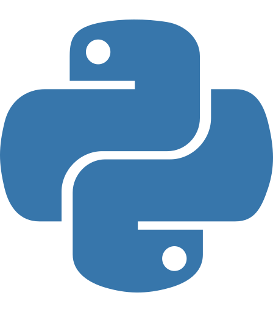

<h1>Hi, I'm Surya Kumar N</h1>

<h3>AI Developer | Automation Engineer | IT Service Delivery Leader</h3>

<i>Building AI-powered solutions, intelligent automations, and enterprise applications that improve operational efficiency and business value.</i>

<b>13+ Years of IT Experience</b> |
<b>AI & Automation</b> |
<b>Enterprise Platforms</b>

<h2>About Me</h2>

IT professional with <b>13+ years of experience</b> in Service Delivery, AI Development, Automation, and Enterprise Platforms.

I specialize in designing and developing practical, business-focused solutions that improve operational efficiency, reporting accuracy, customer experience, and enterprise productivity.

<h2>What I Do</h2>

<ul>
<li>Design and develop AI assistants and intelligent workflows.</li>
<li>Build automation solutions for IT operations, patch management, reporting, and compliance.</li>
<li>Manage NOC / Helpdesk service delivery and customer success.</li>
<li>Develop enterprise applications using Salesforce and Microsoft Power Platform.</li>
<li>Create AI-powered tools that simplify complex business processes.</li>
</ul>

<h2>Tech Stack</h2>

<h3>Programming & Development</h3>

&nbsp;&nbsp;

&nbsp;&nbsp;

&nbsp;&nbsp;

<h3>Salesforce</h3>

<b>SOQL | Lightning Web Components (LWC) | Salesforce Flow</b>

<h3>Microsoft Power Platform</h3>

<b>Power Apps | Power Automate | Power BI | SharePoint</b>

<h3>AI & Automation</h3>

<b>OpenAI | Anthropic | AI Agents | Model Context Protocol (MCP)</b>

<h3>Databases & Cloud</h3>

<b>SQL Server | Snowflake | Microsoft Azure</b>

<h3>Tools & DevOps</h3>

&nbsp;&nbsp;

<b>VS Code | ServiceNow</b>

<h2>Featured Projects</h2>

<h3>Surya AI Assistant</h3>

<b>Personal AI Assistant | AI Integration | Automation</b>

An AI-powered assistant designed to support career development, learning, productivity, and intelligent information retrieval.

<a href="https://suryark88.github.io/surya-ai-agent/">View Live Project</a>

<h3>NOVA — Service Delivery Intelligence</h3>

<b>AI Agents | Salesforce | Automation | Reporting</b>

An enterprise AI assistant designed to improve service delivery operations through:

<ul>
<li>Automated customer account reviews.</li>
<li>Root Cause Analysis (RCA) assistance.</li>
<li>Salesforce and operational data integration.</li>
<li>Intelligent reporting and account insights.</li>
</ul>

<i>Internal enterprise project — source code not publicly available.</i>

<h3>Audit Tracker — Service Delivery</h3>

<b>Microsoft Power Apps | SharePoint | Salesforce | Power BI</b>

A business application designed to streamline service delivery audits and account management.

<ul>
<li>Centralized customer audit management.</li>
<li>NOC and Helpdesk service tracking.</li>
<li>ARR/MRR visibility.</li>
<li>Customer account history.</li>
<li>Salesforce integration and reporting.</li>
</ul>

<i>Internal enterprise project — source code not publicly available.</i>

<h3>IT Reporting & Workflow Automations</h3>

<b>Power Automate | Excel | RMM | API Integration</b>

Designed and implemented automation workflows for IT operations and service delivery.

<ul>
<li>Automated weekly patch compliance reports.</li>
<li>Server and workstation patch status tracking.</li>
<li>Post-patching activity notifications.</li>
<li>Scheduled reporting and data consolidation.</li>
<li>Operational dashboards and reporting workflows.</li>
</ul>

<i>Enterprise automation projects — implementation details are private.</i>

<h2>Let's Connect</h2>

<i>Building intelligent solutions through AI, automation, and enterprise technology.</i>

