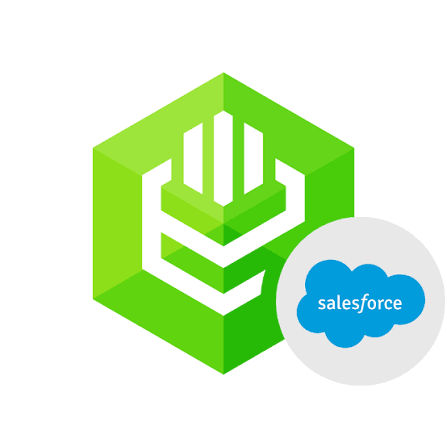
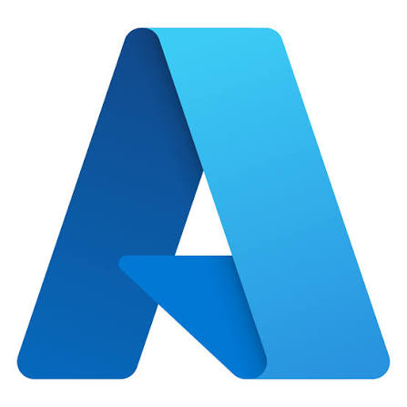

<h1>👋 Hi, I'm Surya Kumar</h1>

<h3>AI Developer | Automation Engineer | IT Service Delivery Leader</h3>

<b>13+ Years of IT Experience</b> &nbsp; | &nbsp;
<b>AI & Automation</b> &nbsp; | &nbsp;
<b>Enterprise Platforms</b>

---

<h2>About Me</h2>

IT professional with <b>13+ years of experience</b> in IT Service Delivery, AI Development, Automation, and Enterprise Platforms.

I specialize in designing and developing business-focused solutions that improve operational efficiency, reporting accuracy, customer experience, and enterprise productivity.

<h2>What I Do</h2>

<ul>
<li>Design and develop AI assistants and intelligent workflows.</li>
<li>Automate IT operations, patch management, reporting, and compliance.</li>
<li>Manage NOC / Helpdesk service delivery and customer success.</li>
<li>Develop enterprise applications using Salesforce and Microsoft Power Platform.</li>
<li>Build AI-powered tools and integrations that simplify complex business processes.</li>
</ul>

---

<h2>Tech Stack</h2>

<h3>Programming & Development</h3>

&nbsp;&nbsp;

&nbsp;&nbsp;

&nbsp;&nbsp;

<h3>Salesforce Development</h3>

&nbsp;&nbsp;

&nbsp;&nbsp;

&nbsp;&nbsp;

<h3>Microsoft Power Platform</h3>

&nbsp;&nbsp;

&nbsp;&nbsp;

&nbsp;&nbsp;

&nbsp;&nbsp;

<h3>AI & Automation</h3>

&nbsp;&nbsp;

AI Agents | Model Context Protocol (MCP) | Intelligent Automation

<h3>Databases & Cloud</h3>

&nbsp;&nbsp;

&nbsp;&nbsp;

<h3>Tools & DevOps</h3>

&nbsp;&nbsp;

---

<h2>🔗 Let's Connect</h2>

  &nbsp;&nbsp;&nbsp;
  

